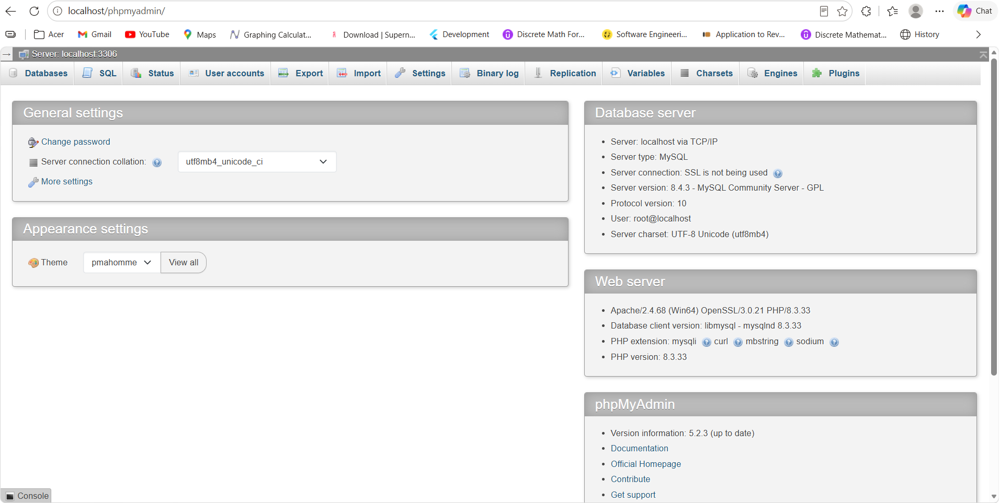
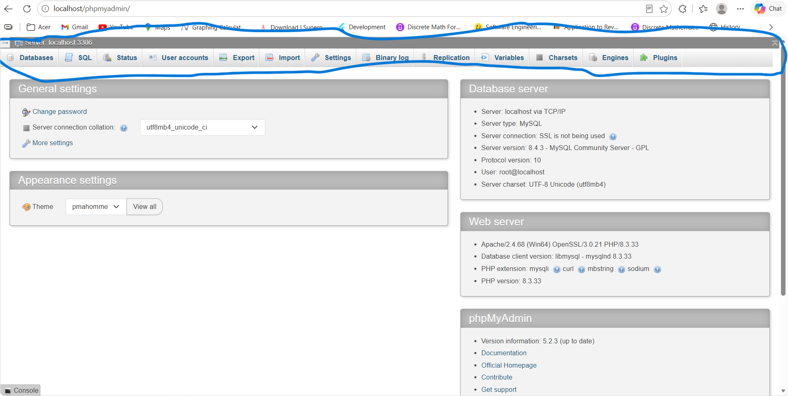
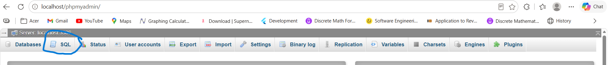
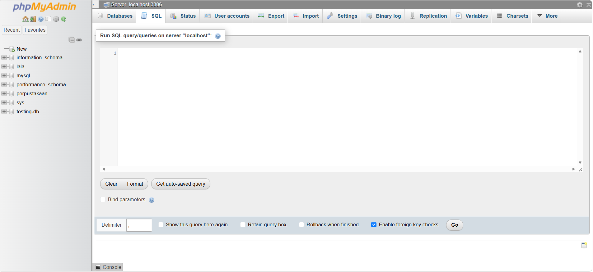

# REST API mini project: Multi-merchant store 🏬

Flask project that builds a multi-merchant store REST API. It demonstrates user authentication with JWT, role-based access control, store and product management (CRUD), product claiming, database relationships using Flask-SQLAlchemy, and catalog features such as search, filtering, and pagination.

## 💻 System Requirement
 - Python 3.14.3(make sure to click the "Add Python to PATH" button befor download)
 - MySQL Database Server(you can use XAMPP or Laragon, but i use Laragon)
 - Postman(for API testing)
 - Vs code(Code editor) or you can also use Antigravity IDE(make sure the antigravity that you are download has a black background)

## ⚙️ Project structure 

```
├── app/
│   ├── __init__.py
│   ├── config.py
│   ├── models.py
│   ├── errors.py
|   |── extensions.py
│   └── routes/
│       ├── auth.py
│       ├── merchants.py
│       ├── products.py
│       ├── catalog.py
│       └── claims.py
|── Database/schema.sql
├── requirements.txt
└── run.py
```
## 🗄 Database Configuration
1. Start Laragon. After installing Laragon, open the Laragon Control Panel and click Start All to start the required services.
2. Open phpMyAdmin. In the Laragon Control Panel, click Menu, select MySQL, and then click phpMyAdmin.
3. Log in to phpMyAdmin. Your browser will open the phpMyAdmin login page. By default, Laragon uses the following credentials:
    - Username: root(your username, but i use teh default which is root)
    - Password: no password(your password, but by default we dont need password)
4. Enter root as the username and password( or just let it blank), and click Log in.
5. When you finally login to the phpMyAdmin page, you will see this page:
   
7. In the navigation bar above, pick the "SQL" button, and it will lead you to the SQL Query Editor

    
    
    
    
    
8.In the the SQL Query Editor Create the database name "perpustakaan" with the following Query:

     CREATE DATABASE db_store;
    

## 🚀 To run the application

### 1. Make a folder to make 
Create a new folder where you want to store your project.

For example, you can create a folder named ```Projects```.

### 2. Clone the Repository
Open your terminal (Command Prompt, PowerShell, or VS Code terminal) and run


For example, if you created GitHub Projects on your Desktop, run:
```
cd <Folder_location>\Projects
```
Next, run the following command to clone the repository from GitHub:

```
git clone https://https://github.com/Anya10032004/multi-merchant_store
```
Git will download the repository and create a new folder containing the project files.

### 3. Open the Project Folder
Next, enter the downloaded folder by running:

```
cd "<Folder_location>\multi-merchant_store"
```
### 4. Make a virtual enviroment
After that, we will make a virtual enviroment with a name perpustakaan, we will need to the following commands:

```
python -m venv store
```

### 5. Activate the virtual enviroment
Commands to  activate the virtual enviroment is based on terminal you will use:

- Windows PowerShell:

   ```
   .\store\Scripts\Activate.ps1
   ```
   
- Windows Command Prompt (CMD):
  
   ```
   .\store\Scripts\Activate.ps1
   ```
   
- Git Bash / Linux / macOS:
  
  ```
  source store/Scripts/activate
  ```
You can tell that the virtual environment is active when you see the prefix (perpustakaan) at the beginning of your terminal prompt.

### 6. Install the Required Libraries from ```requirements.txt```
After the virtual enviroment is active, we will need to install some libraries 
```
pip install -r requirements.txt
```

### 7. Configure the Database Connection
  Open main.py to the code editor(I will demonstrate how to use it with VS Code) from the terminal:

  ```
  cd "<Folder_location>\RestAPIMiniProject_Perpustakaan"
  code .
  ```

  and find the database connection configuration. Set it to the following URL:

        ```
        mysql+pymysql://root:@localhost:3306/perpustakaan
        ```
   | Component       | Value           | Description                                                                                                                                    |
   |-----------------|-----------------|------------------------------------------------------------------------------------------------------------------------------------------------|
   | Database Driver | `mysql+pymysql` | Specifies MySQL as the database and PyMySQL as the Python driver.                                                                              |
   | Username        | `root`          | The MySQL username used to connect to the database.                                                                                            |
   | Password        | Empty           | The password to configured for this setup(by default, we dont need password)                                                                   |
   | Host            | `localhost`     | Connects to MySQL running on your own computer. If MySQL runs on another server, replace `localhost` with the server's IP address or hostname. |
   | Port            | `3306`          | The default MySQL port. Change it if your MySQL server uses a different port.                                                                  |
   | Database Name   | `store`         | The name of the database created in Step 8.                                                                                                    |
   
   **Important**: Make sure the username, password, host, port, and database name match your MySQL configuration. If you use a password, add it after root: in the connection URL.
   
   **Note**: This configuration assumes MySQL is running locally and the root account has no password. For production environments, use a dedicated database user with a strong password instead of the root account.


### 8. Run the app

Run the ```app.py```:

    python run.py
    
If it works the output will be:

```
 * Serving Flask app 'app'
 * Debug mode: on
 * Running on http://127.0.0.1:5000
```

The ```Users```, ```Merchants```,  ```Products```, and ```Claims``` tabbles will be automattically made when we run the app 

## ⚙️ API testing(NOT DONE)
| Method | Endpoint | Access | Purpose |
|---|---|---|---|
| GET | `/api` | Public | Main page |
| POST | `/api/register` | Public | Register a user or merchant |
| POST | `/api/login` | Public | Login and receive a JWT |
| POST | `/api/merchants` | Merchant | Create merchant profile |
| GET | `/api/merchant/me` | Merchant | See your own store profile|
| PUT | `/api/merchant/me` | Merchant | Update own store profile |
| GET | `/api/merchants` | Merchant | List merchant's store profiles |
| GET | `/api/merchants/<id>` | Merchant | See merchant and its products |
| POST | `/api/products` | Merchant | Create a product |
| GET | `/api/products/mine` | Merchant | List own products |
| PUT | `/api/products/<id>` | Merchant | Update own product |
| DELETE | `/api/products/<id>` | Merchant | Delete own product |
| GET | `/api/catalog` | User | search available products |
| GET | `/api/catalog/<id>` | User | Get Detail information of the product|
| POST | `/api/claims` | User | Claim a product and reduce stock |
| GET | `/api/claims` | User | List own claims |

For protected endpoints, send the token in the request header:

```text
Authorization: Bearer YOUR_ACCESS_TOKEN
```


### 1. Home API
 - Method: `GET`
 - URL: `http://127.0.0.1:5000/api `
 - Response Expected (200 OK):
   ```
    {
    "message": "Welcome to the API WAHHHHHHH",
    "status": 200
    }
   ```
### 2. Register  API 
 - Method: `POST`
 - URL: `http://127.0.0.1:5000/api/register`
 - Body(JSON):
   ```
   {
    "name": "Lele",
    "email": "lele123@gmail.com",
    "password": "lele123",
    "role": "Merchant"
   }
   ```
 - Response Expected:
   ```
   {
    "data": {
        "email": "lele123@gmail.com",
        "id": 14,
        "name": "Lele",
        "password": "scrypt:32768:8:1$KtZ8FtnzMJmdhNFm$852d208899181d48a211c366a7eb5abd7b55965abfdc304cf9ac72c67bb83bc9642917c332ad5f1d48cbdebdc1cb8cc9f7567e29d11ec4681c92d14e2b6f40dd",
        "role": "merchant"
    },
    "message": "User added successfully",
    "status": 201
   }
   ```
 - Method: `POST`
 - URL: `http://127.0.0.1:5000/api/register`
 - Body(JSON):
   ```
   {
    "name": "lola",
    "email": "lola123@gmail.com",
    "password": "lola123",
    "role": "User"
   }
   ```
 - Response Expected:
   ```
   {
    "data": {
        "email": "lola123@gmail.com",
        "id": 15,
        "name": "lola",
        "password": "scrypt:32768:8:1$ENyg79W25yeGIGhw$b869e7827ddc3ac154f8f6ac3a00cc9af9a09bd3e1cdd5d2e2dd015560d9195dda431e859c3c5d0e27a68665042b207befcc420496a0deddef9d2d443361697f",
        "role": "user"
    },
    "message": "User added successfully",
    "status": 201
   }

   ```


### 3. Login API
 - Method: `POST`
 - URL: `http://127.0.0.1:5000/api/login `
 - Body(JSON):
   ```
   {
    "email": "lola123@gmail.com",
    "password": "lola123"
    }
   ```
 - Response Expected:
   ```

   {
    "Acess Token": "eyJhbGciOiJIUzI1NiIsInR5cCI6IkpXVCJ9.eyJmcmVzaCI6ZmFsc2UsImlhdCI6MTc5NDQ3OTA1MCwianRpIjoiODZiNmYxNWEtYWFhZC00Nzg3LTllZTAtNWI1MmFmYjZkMjYxIiwidHlwZSI6ImFjY2VzcyIsInN1YiI6IjE1IiwibmJmIjoxNzk0NDc5MDUwLCJjc3JmIjoiNTFlYzdjZDctNTQ2ZS00Y2I1LWE1MmEtMzRiNzIwZjZhM2RlIiwiZXhwIjoxNzk0NTY1NDUwLCJpZCI6MTUsIm5hbWUiOiJsb2xhIiwiZW1haWwiOiJsb2xhMTIzQGdtYWlsLmNvbSIsInBhc3N3b3JkIjoic2NyeXB0OjMyNzY4Ojg6MSRFTnlnNzlXMjV5ZUdJR2h3JGI4NjllNzgyN2RkYzNhYzE1NGY4ZjZhYzNhMDBjYzlhZjlhMDliZDNlMWNkZDVkMmUyZGQwMTU1NjBkOTE5NWRkYTQzMWU4NTljM2M1ZDBlMjdhNjg2NjUwNDJiMjA3YmVmY2M0MjA0OTZhMGRlZGRlZjlkMmQ0NDMzNjE2OTdmIiwicm9sZSI6InVzZXIifQ.T9OI5yB1gZ8B4yalB9bJTW6fq8ttKUvFD04Vb_LNdEA",
    "data": {
        "email": "lola123@gmail.com",
        "id": 15,
        "name": "lola",
        "password": "scrypt:32768:8:1$ENyg79W25yeGIGhw$b869e7827ddc3ac154f8f6ac3a00cc9af9a09bd3e1cdd5d2e2dd015560d9195dda431e859c3c5d0e27a68665042b207befcc420496a0deddef9d2d443361697f",
        "role": "user"
    },
    "message": "Login successful",
    "status": 200
   }
  
    
   ```


### 4. Product API(Only for user with the "Merchant" role)
#### a. Add Product to store
 - Method: `POST`
 - URL: `http://127.0.0.1:5000/api/buku `
 - Body(JSON):
   ```
   {
    "name": "Shampoo",
    "description": "A soap for the hair i guess",
    "price":"30000",
    "stock": "10"
   }
   ```
 - Response Expected:
   
   ```
   {
    "data": {
        "description": "A soap for the hair i guess",
        "id": 12,
        "id_merchant": 4,
        "price": 30000,
        "product_name": "Shampoo",
        "stock": 10
    },
    "message": "Product added successfully",
    "status": 201
   }
   ```
#### b. Look at merchant own product API
- Method: `GET`
 - URL: `http://127.0.0.1:5000/api/products/mine`
 - Response Expected:
   ```
   {
    "data": [
        {
            "description": "A soap for the hair i guess",
            "id": 12,
            "id_merchant": 4,
            "price": 30000,
            "product_name": "Shampoo",
            "stock": 10
        },
        {
            "description": "Kue sus dari jakara",
            "id": 15,
            "id_merchant": 4,
            "price": 10000,
            "product_name": "Kue sus",
            "stock": 20
        },
        {
            "description": "Sabun mandi biore isi 5000 ml",
            "id": 16,
            "id_merchant": 4,
            "price": 30000,
            "product_name": "Sabun biore",
            "stock": 30
        },
        {
            "description": "Jus kotak lemonne",
            "id": 17,
            "id_merchant": 4,
            "price": 15000,
            "product_name": "Jus lemonn",
            "stock": 30
        }
    ],
    "message": "List of yoru products",
    "status": 200
   }
    
   ```
#### c. Delete product based on ID 
 - Method: `DELETE`
 - URL: `http://127.0.0.1:5000/api/buku/13`
 - Response Expected:
   ```
   {
    "message": "Product deleted successfully",
    "status": 200
   }
   ```
#### d. Update product based on ID
- Method: `PUT`
 - URL: `http://127.0.0.1:5000/api/products/15`
 - Body(JSON):
   ```
   {
    "name": "Kue sus jakarta dna bandung sekarang",
    "description": "Kue sus nya diproduksi di jakarta bandung"
   }
   ```
 - Response Expected:
```
{
    "data": {
        "description": "Kue sus nya diproduksi di jakarta bandung",
        "id": 15,
        "id_merchant": 4,
        "price": 10000,
        "product_name": "Kue sus",
        "stock": 20
    },
    "message": "Product updated successfully",
    "status": 200
}
```
### 5. Catalog API(For User with role "User" only)

#### e. See catalog of the product
 - Method: `GET`
 - URL: `http://127.0.0.1:5000/api/catalog`
 - Response Expected:

```
{
    "data": [
        {
            "Product name": "Biore",
            "Store name": "Anya store",
            "stock": 11
        },
        {
            "Product name": "Biore",
            "Store name": "Anya store",
            "stock": 12
        },
        {
            "Product name": "Ponds",
            "Store name": "Anya store",
            "stock": 12
        },
        {
            "Product name": "Ponds",
            "Store name": "Anya store",
            "stock": 12
        },
        {
            "Product name": "vanila milk",
            "Store name": "Anya store",
            "stock": 10
        },
        {
            "Product name": "cake ko",
            "Store name": "Anya store",
            "stock": 100
        },
        {
            "Product name": "juice fun fun",
            "Store name": "Anya store",
            "stock": 10
        },
        {
            "Product name": "Chips fun fun",
            "Store name": "hoho store 2",
            "stock": 6
        },
        {
            "Product name": "Fanta",
            "Store name": "hoho store 2",
            "stock": 2
        },
        {
            "Product name": "Shampoo",
            "Store name": "haha",
            "stock": 10
        },
        {
            "Product name": "Kue sus",
            "Store name": "haha",
            "stock": 20
        },
        {
            "Product name": "Sabun biore",
            "Store name": "haha",
            "stock": 30
        },
        {
            "Product name": "Jus lemonn",
            "Store name": "haha",
            "stock": 30
        }
    ],
    "message": "List of products",
    "status": 200
}

```
#### f. See details of the product
 - Method: `GET`
 - URL: `http://127.0.0.1:5000/api/catalog/11`
 - Response Expected:
   ```
   {
    "data": [
        {
            "description": "Sodaa",
            "id": 11,
            "id_merchant": 3,
            "price": 15000,
            "product_name": "Fanta",
            "stock": 2
        }
    ],
    "message": "Product found",
    "status": 200
   }
   ```

#### g. Claim the product
 - Method: `POST`
 - URL: `http://127.0.0.1:5000/api/claims`
 - Body(JSON):
   ```
 - Body(JSON):
   ```
   {
    "id_product": 11,
    "quantity": 3
   }
   ```
 - Response Expected:
   ```
   {
    "message": "Not enough stock, only 2 left",
    "status": 400
   }
   ```
 - Method: `POST`
 - URL: `http://127.0.0.1:5000/api/claims`
 - Body(JSON):
   ```
   {
    "id_product": 11,
    "quantity": 1
   }
   ```
 - Response Expected:
   ```
   {
    "data": {
        "create_at": "2026-11-12T22:45:57",
        "id": 5,
        "id_product": 11,
        "id_user": 15,
        "quantity": 1
    },
    "message": "Claim added successfully",
    "status": 201
   }
   ```
